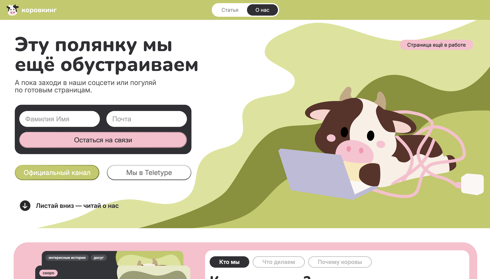
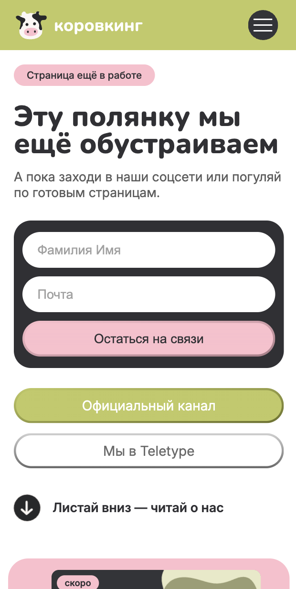

# [Коровкинг]

[Медиа для поиска мест для работы и учебы вне дома]

## Ссылки

- Сайт: []
- Макет в Figma: [https://www.figma.com/design/y6CtpVCP31QpTMqgUpUSLe/2-%D0%BA%D1%83%D1%80%D1%81-%D0%A1%D0%A2%D0%A1?node-id=1046-727&p=f&t=yTVTS6NDR1MIFxAP-0]

## Скриншоты

 

## Команда

| Участник | Что делал(а) |
| [Полина] | [Дизайн сайта: "О нас", "Главная", "Статья Один кофе — сколько пастись?"; Код (полноценная вёрстка с адаптивами): "Заглушка" + "О нас"] |
| [Имя] | [страницы, компоненты, задачи] |

## Стек

- [Инструмент и версия]
- [Инструмент и версия]

## Как запустить локально

```bash
git clone [адрес репозитория]
cd [coworkig]
npm install
npm run dev
```

## Структура проекта

```
src/
├── fonts/                  # Шрифты проекта
├── images/                 # Изображения проекта
├── javascript/             # JavaScript-файлы
├── pages/                  # Страницы сайта
│   ├── articles/           # Страницы отдельных статей
│   ├── places/             # Страницы отдельных мест
│   ├── about.html          # Страница о проекте
│   ├── articles.html       # Список статей
│   ├── places.html         # Список мест
│   └── tests.html          # Страница с тестами
├── stylesheets/            # CSS-стили
│   ├── adaptive.css        # Адаптивная вёрстка
│   ├── animation.css       # Анимации
│   ├── fonts.css           # Подключение шрифтов
│   ├── home.css            # Стили главной страницы
│   ├── article.css         # Стили статей
│   ├── main_styles.css     # Основные стили сайта
│   ├── reset.css           # Сброс стандартных стилей
│   └── style.css           # Дополнительные стили
└── index.html              # Главная страница сайта
```

## Решения и сложности

[Полина]

- Честно, было сложно почему то с SVG фоткой на заглушке, я её и так и сяк, вообще никак не хотела вставть и адаптироваться так как надо. Спасибо ИИ, что помог разобраться в чём дело. Брейкпоинты по контенту: точки перелома ставила там, где вёрстка начинала ломаться: 1380px (убрала обложку статьи, она сжимала текст), 1240, 1100, 925, 768 (бургер), 700 и 600px. Было очень сложно! Столько брейкпоинтов (изза того что много объектов), так как я хотела сделать их только 3-4 и чтобы не сильно различались экраны, но всё равно я с этим справлась и сделала нормальные адаптивы (очень на это надеюсь).
- Осознанно не сильно не заморачивалась с анимациями на сайте. В следующем модуле будем всё конкретно разберать и менять, поэтому сильно нервничать смысла не вижу.

## Использование ИИ

### Инструменты

| Инструмент и модель | Кто      | Для каких задач                | Уровень (0–4) |
| ------------------- | -------- | ------------------------------ | ------------- |
| [Cloade]            | [Полина] | [Картинка на заглушке, код]    | [1]           |
| [Cloade]            | [Полина] | [Анимация карточек]            | [4]           |
| [Cloade]            | [Полина] | [Адаптив]                      | [2]           |
| [Cloade]            | [Полина] | [Моментами верстка «поехала»]  | [2]           |
| [Cloade]            | [Полина] | [Стилизации формы на заглушке] | [2]           |
| [ChatGPT]           | [Все]    | [Чтобы коровы были милыми]     | [1]           |
| [ChatGPT]           | [Даша]   | [Текст для статьи]             | [4]           |

### Журнал в docs/ai-log.md

### Рефлексия

[5–10 предложений: где ИИ помог, где ошибался, что не взяли в проект, чему научились, что сделали бы иначе.]
